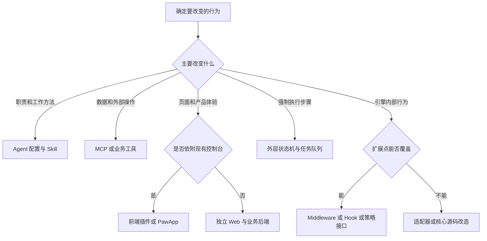
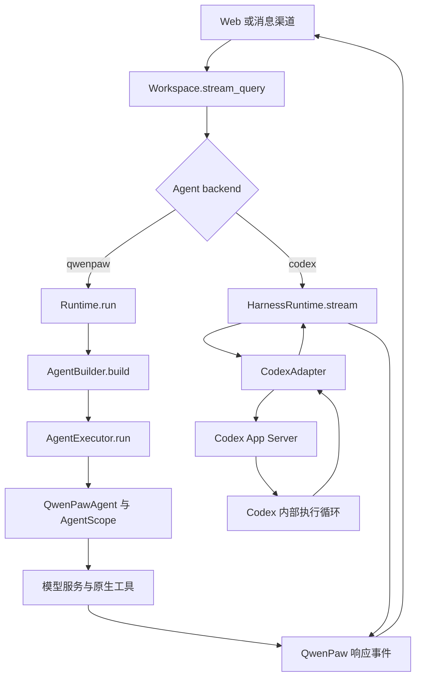
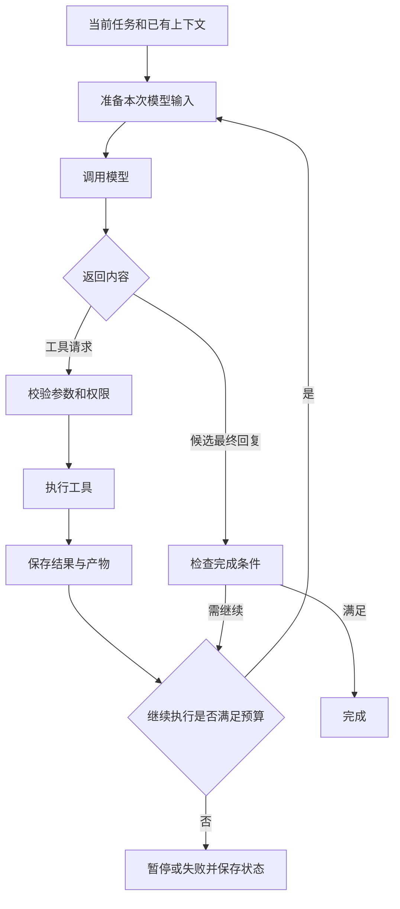
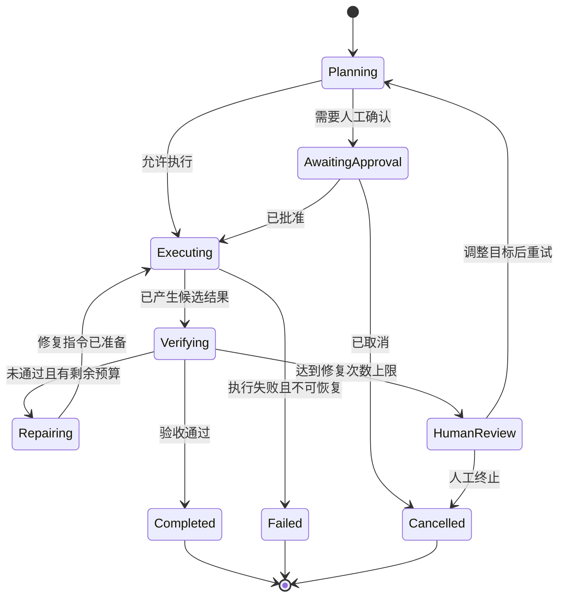
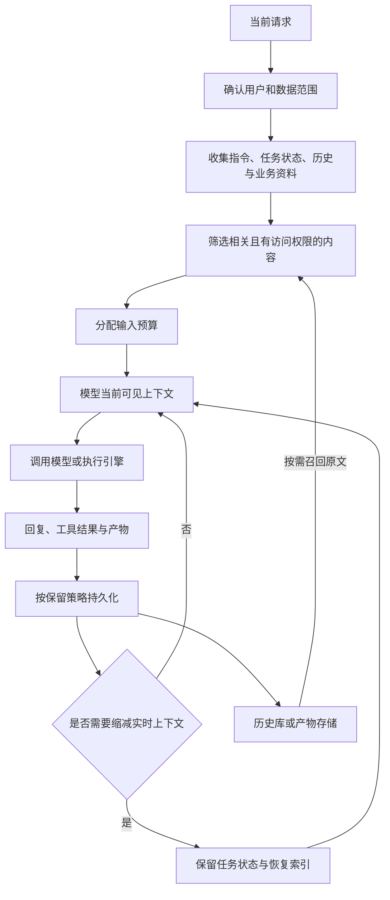
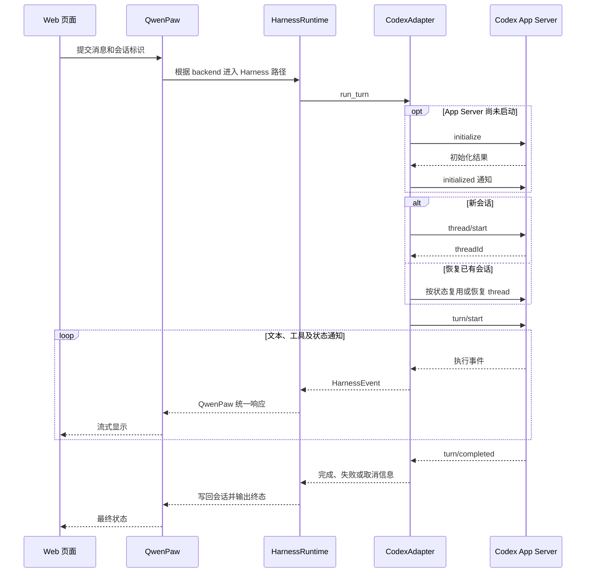
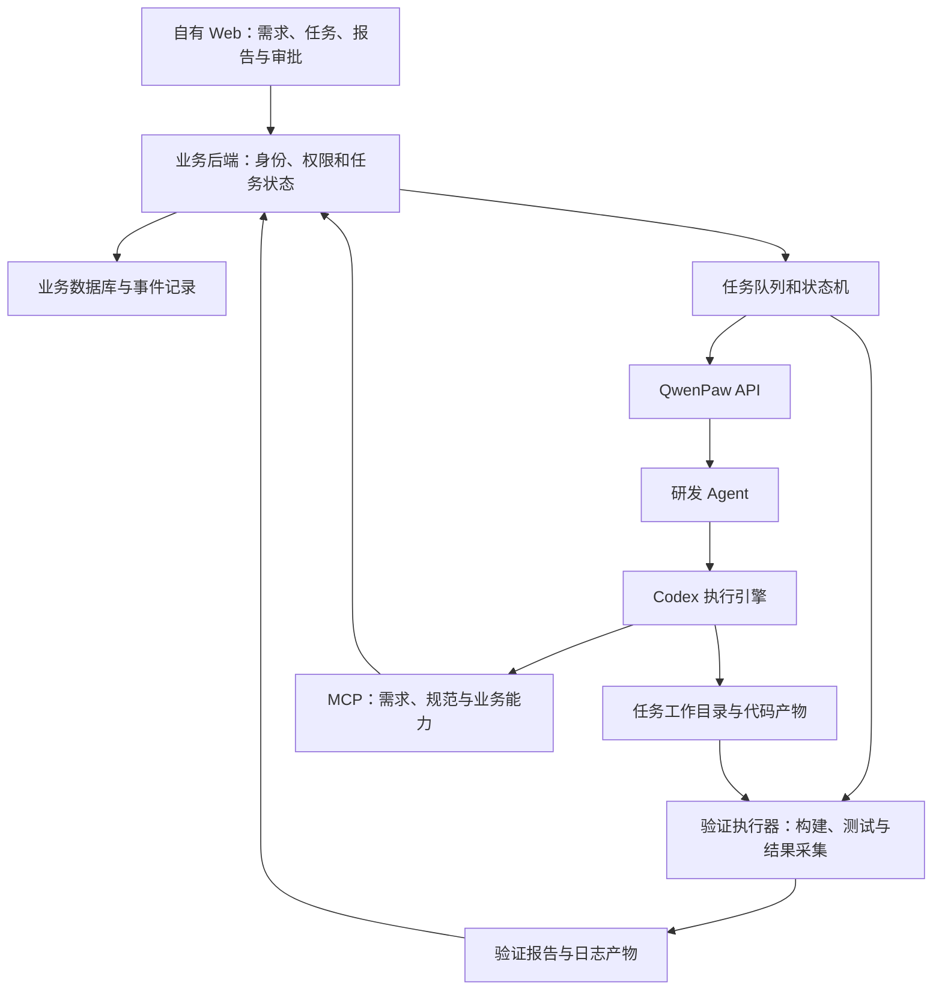

# QwenPaw 定制开发指南

本文用于选择 QwenPaw 定制路线，并定位需要修改的配置、插件或源码。重点说明推理循环、上下文处理、执行协议，以及使用 Codex 时的实际控制边界。

外部执行引擎的适配接口、注册流程、能力投射和会话管理，另见 [Harness 接入与能力指南](HARNESS_INTEGRATION_GUIDE.zh.md)。

- 源码基线：QwenPaw **2.2.2**，提交 `5c56644a6e130762a236f8c946103e95a0a1eec8`。
- 适用场景：个人智能体、内部工作台、PawApp、基于 QwenPaw API 的独立 Web 应用。
- **现有机制**指在上述源码中确认的实现；**建议方案**指需要额外开发的业务设计。
- 本文涉及的权限、记忆、工具和生命周期扩展，应按实际执行后端分别验收。

## 1. 定制分类与选型

| 定制目标 | 典型需求 | 优先方案 | 主要交付物 |
| --- | --- | --- | --- |
| 角色与职责 | 研发、产品、研究助手 | 独立 Agent、工作区指令 | 角色说明、工作边界、输出要求 |
| 专业工作方法 | 审查代码、分析竞品 | Skill，附参考资料与脚本 | `SKILL.md`、示例、验收案例 |
| 业务能力 | 查询订单、操作工单 | MCP 或工具插件 | 工具接口、参数校验、权限控制 |
| 专业知识 | 内部规范、产品手册 | 文件资料；规模扩大后使用检索服务 | 知识源、索引、检索与来源引用 |
| 长期记忆 | 项目背景、用户偏好 | 内置记忆配置；特殊需求评估 Memory 插件 | 记忆范围、存储、检索与清理规则 |
| 固定流程 | 审批、批处理、定时执行 | 业务状态机、队列、Cron | 任务状态、重试与恢复机制 |
| 多智能体 | 产品、开发、测试协作 | 多 Agent、职责描述与协作入口 | 分工、交接规则、共享产物 |
| 模型与引擎 | 云模型、Codex、新执行器 | 模型配置、Provider 插件或 HarnessAdapter | 配置或适配器 |
| 品牌与现有页面 | 名称、颜色、布局 | 修改 `console/` | 控制台构建产物 |
| 新业务模块 | 看板、报告中心 | 前端插件或 PawApp，配套业务 API | 页面、接口、存储 |
| 独立 Web 产品 | 自有导航、账号、业务流程 | 独立前后端调用 QwenPaw API | 产品应用、业务服务、执行接入 |
| 消息渠道 | 钉钉、飞书、自有渠道 | 现有 Channel 或 Channel 插件 | 渠道配置、消息转换 |
| 底层行为 | 模型调用、上下文策略、执行事件 | Middleware、生命周期 Hook、策略实现或核心改造 | 扩展实现、兼容与回归测试 |

以下为**选型建议**，一个项目可以组合多种方案：

### 选型时的三个区别

1. **工作规则与强制约束**：指令、Skill 可以指导执行；权限校验、审批条件、金额限制等应由程序实施。
2. **记忆与业务记录**：记忆帮助理解任务；订单、审批、金额、任务终态等应有明确的业务数据来源。
3. **模型与执行引擎**：模型服务提供推理接口；Codex 等执行引擎还管理工具执行、线程与内部循环，接入位置不同。

## 2. 双执行路径：先确定改动会落到哪里

### 2.1 当前源码中的分流

`Workspace.stream_query()` 读取 Agent 的 `backend`：`qwenpaw` 进入原生 Runtime，其余后端进入 HarnessRuntime。下面是**现有调用关系的简化图**，省略了渠道队列和部分事件封装。

源码入口：[Workspace](src/qwenpaw/app/workspace/workspace.py)、[原生 Runtime](src/qwenpaw/runtime/runtime.py)、[HarnessRuntime](src/qwenpaw/harnesses/runtime.py)。

### 2.2 不同后端的控制边界

| 定制项 | 原生 `qwenpaw` 后端 | `codex` 后端 |
| --- | --- | --- |
| 每次模型调用前后的处理 | 可通过原生 Middleware 等入口扩展 | 取决于 Codex 暴露的能力，原生 Middleware 不会自动生效 |
| 工具执行循环 | QwenPaw 与 AgentScope 共同实现 | Codex 内部实现 |
| 模型可见历史的压缩与恢复 | 原生 ContextManager，例如 Scroll | Codex 自己管理线程内部历史 |
| Skills 与 MCP | 原生能力装配 | 有投射到 Codex 的适配实现，需逐项验证 |
| 对外任务步骤与业务审批 | 可由外层业务服务控制 | 可由外层业务服务控制 |
| 页面与业务数据 | 可由应用层扩展 | 可由应用层扩展 |

注意：原生 Runtime 的八阶段 Hook 在原生路径执行；如果需要让自定义前后处理覆盖 Codex，应选择分流之前的公共入口、业务服务或 Harness 路径，并验证实际调用关系。

## 3. 推理循环定制

### 3.1 控制的对象

这里的推理循环指应用层对模型调用、工具执行、结果回填和结束条件的调度。

下面是**通用循环示意**，用于理解定制位置，并非源码逐行对应图：

### 3.2 原生执行路径的扩展层次

| 层次 | 作用范围 | 适合处理的事情 | 源码入口 |
| --- | --- | --- | --- |
| 生命周期 Hook | 一次原生请求的准备、执行前后、错误与清理 | 加载会话、准备资料、保存状态、记录请求 | [runtime/phases.py](src/qwenpaw/runtime/phases.py)、[runtime/hooks.py](src/qwenpaw/runtime/hooks.py) |
| Middleware | Agent 内部推理与执行过程 | 调用观测、输入增强、结果处理 | [plugins/api.py](src/qwenpaw/plugins/api.py)、[agents/middlewares.py](src/qwenpaw/agents/middlewares.py) |
| Agent 方法与循环控制 | 原生模型调用及工具执行行为 | 特殊恢复策略、停止条件、底层调用控制 | [react_agent.py](src/qwenpaw/agents/react_agent.py)、[loop/gates/runner.py](src/qwenpaw/loop/gates/runner.py) |
| 外层业务编排 | 一个业务任务中的多个 Agent 请求 | 强制阶段、审批、失败修复、人工接管 | 建议在自有业务服务实现 |

原生生命周期包含 `PRE_DISPATCH`、`POST_DISPATCH`、`PRE_AGENT_BUILD`、`POST_AGENT_BUILD`、`PRE_EXECUTE`、`POST_RESPONSE`、`ON_ERROR`、`FINALLY`。这些阶段围绕一次请求；Middleware 围绕 Agent 内部处理过程。两种入口的职责应分别设计。

当前插件 API 支持 `register_middleware(factory, priority=...)`。工厂接收请求上下文和 Agent 配置，返回 AgentScope Middleware 或 `None`。具体方法签名应以当前 AgentScope 版本与项目示例为准。

### 3.3 建议方案：规划、执行、验证、修复

若要求“只有测试通过才能完成”，建议使用可持久化的业务状态机。以下状态名为**业务设计示例**，需要额外实现：

建议持久化 `task_id`、当前阶段、尝试次数、验收条件、产物位置和失败原因。每个阶段可以调用一次或多次 Agent；业务程序负责阶段转换。

在 Codex 路径中，可以通过多次回合完成上述外层流程。仅修改 CodexAdapter 无法保证获得 Codex 内部每一次模型调用的控制权；需要先确认引擎是否提供相应接口。

## 4. 上下文处理定制

### 4.1 从信息源到模型输入

上下文处理负责决定“模型此刻能看到哪些信息”。可以调整资料获取、相关性筛选、长度预算、工具结果裁剪、历史保存和召回。

下面是**建议的数据处理流程**，可以按场景实现其中部分步骤：

### 4.2 当前原生实现与扩展入口

原生默认 Scroll 策略会持久化历史，并在需要时将较早内容移出实时上下文，保留任务状态摘要及可展开索引。原始历史和摘要承担不同职责，精确事实应能回到持久化来源。

`ContextManager` 接口提供三个主要入口：

| 方法 | 现有职责 | 定制时应关注 |
| --- | --- | --- |
| `on_save(agent, blocks)` | 响应新增上下文，支持持久化 | 会话归属、写入去重、保存失败 |
| `compress(agent, context_config, instructions)` | 缩减实时上下文 | 保留约束、关联工具结果、控制输入长度 |
| `recover_from_context_overflow(agent)` | 在提供方拒绝超长输入后恢复 | 确认输入实际改变，再进行有界重试 |

源码入口：[ContextManager 接口](src/qwenpaw/agents/context/base.py)、[ScrollContextManager](src/qwenpaw/agents/context/scroll/manager.py)、[AgentBuilder](src/qwenpaw/runtime/builder.py)。当前 Builder 会向原生 Agent 注入上下文管理器；新策略还需要接入装配与配置选择，不能只新增一个类。

详细现有行为见[上下文管理文档](website/public/docs/context.zh.md)。

### 4.3 常见定制场景

| 场景 | 建议方案 | 验证重点 |
| --- | --- | --- |
| 超大日志 | 保存原文件，输入失败摘要和读取位置 | 关键堆栈、错误码和原始行号能够追溯 |
| 大型代码库 | 先提供项目地图，再按任务获取文件片段 | 引用对应当前工作树或提交 |
| 企业知识 | 按用户权限检索相关文档，附来源和版本 | 不同用户检索范围正确，旧版本不会混入 |
| 长期任务 | 保存约束、决定、进度和待办，按需召回证据 | 中断恢复后仍知道未完成项和验收条件 |
| 多租户产品 | 从检索、历史、缓存到产物都带隔离标识 | 无法通过猜测任务或会话 ID 跨租户读取 |

对 Codex 的上下文定制，优先控制回合输入、附件、工作目录、Skills 和 MCP 检索能力。CodexAdapter 的能力投射见 [projection.py](src/qwenpaw/harnesses/codex/projection.py)。其内部线程窗口与压缩机制仍由 Codex 管理，原生 Scroll 配置不会自动接管。

## 5. 执行协议定制

### 5.1 区分四条边界

| 边界 | 交换内容 | 修改位置 |
| --- | --- | --- |
| Web 与应用服务 | 消息、会话、流式响应、任务状态 | 前端 API 层、业务 API、Console 路由 |
| QwenPaw 与执行引擎 | 回合输入、模型设置、事件、取消与恢复 | HarnessAdapter 与对应引擎实现 |
| 引擎与工具 | 工具参数、执行结果、错误、审批 | MCP 服务、工具实现及引擎支持的策略 |
| 原生客户端与模型服务 | 模型请求与响应格式 | Provider 与协议适配实现 |

模型服务接入与执行引擎接入应分别选型：调用模型 HTTP 接口通常评估 Provider；接入带线程、工具循环和登录状态的执行器则评估 HarnessAdapter。

### 5.2 现有 Codex 调用时序

以下描述当前适配实现的主要交互，省略登录、Skills/MCP 配置投射及部分通知：

`turn/completed` 表示回合到达终态，实际成功与否仍需检查状态和错误。不能仅根据收到最后一条通知就将业务任务判定为成功。

### 5.3 现有统一事件与建议业务事件

当前 `HarnessEventKind` 包含：`text_delta`、`reasoning_delta`、`tool_started`、`tool_progress`、`tool_completed`、`completed`、`cancelled`、`error`。这些是内部适配事件，前端收到的是进一步封装后的 QwenPaw 响应。

源码入口：[HarnessAdapter](src/qwenpaw/harnesses/base.py)、[事件模型](src/qwenpaw/harnesses/events.py)、[CodexAdapter](src/qwenpaw/harnesses/codex/adapter.py)、[App Server 客户端](src/qwenpaw/harnesses/codex/app_server.py)。

独立业务应用可以额外设计 `task.started`、`stage.changed`、`approval.required`、`artifact.created`、`task.completed` 等事件。这些名称属于**建议的业务协议**，当前代码不会因为文档定义而自动产生它们。

建议事件字段包括：`schema_version`、`event_id`、`task_id`、`agent_id`、`session_id`、`attempt`、`sequence`、`type`、`occurred_at` 和 `payload`。业务服务应完成事件持久化、权限过滤和前端恢复读取。

### 5.4 协议必须定义的行为

- **终态**：成功、失败、取消分别表达；连接关闭与任务完成分开记录。
- **取消**：记录取消请求，等待执行器确认，必要时处理仍在运行的工具进程。
- **重连**：明确能否继续读取事件、是否重复投递，以及如何恢复显示。
- **重试**：任务尝试次数与工具业务操作的幂等键分别管理。
- **审批**：审批关联具体操作和参数，修改参数后重新判断审批是否有效。
- **版本兼容**：新增字段、未知事件和不支持的能力应有明确处理方式。
- **可观测性**：能够从业务任务关联到 Agent 会话、引擎线程、工具调用和产物。

文本流与对外提供的 reasoning 事件可以用于进度展示，但可靠的任务完成判断应依据执行状态、工具证据和验收结果。

## 6. 示例：基于 Codex 的研发工作台

本节为**建议方案**。当前部署已验证 Codex 登录、模型发现和一轮简单对话；任务状态机、持久化业务事件、自动测试修复、业务审批等仍需开发和验证。

建议职责划分：

| 组件 | 负责的内容 |
| --- | --- |
| Web | 展示任务、阶段、日志和产物，收集审批 |
| 业务后端 | 身份权限、需求记录、任务状态、事件与接口幂等 |
| 队列与状态机 | 调度、并发限制、重试、超时、人工接管 |
| QwenPaw | Agent 管理、会话接入、执行引擎适配与可用扩展 |
| Codex | 代码理解、修改及其内部工具执行 |
| 验证执行器 | 在指定代码版本上运行明确检查，保存证据 |

### 最小落地顺序

1. 选择一个任务类型，明确输入、输出、执行目录和验收命令。
2. 创建专属 Agent，配置 Codex、工作区规则及一个专业 Skill。
3. 打通业务任务到 QwenPaw 回合的关联，记录产物位置。
4. 增加程序化验证，形成“执行→验证→有界修复”的闭环。
5. 增加任务状态和事件记录，再开发进度与审批页面。
6. 用超时、取消、重启、重复请求验证恢复行为，随后扩展任务类型。

测试命令应由项目或业务规则确定。业务完成条件应检查退出码和测试报告等证据，而不是仅检查模型回复中是否出现“已通过”。

## 7. 实施入口与源码导航

| 要修改的内容 | 首先查看 |
| --- | --- |
| 执行后端分流 | [workspace.py](src/qwenpaw/app/workspace/workspace.py) |
| 原生请求生命周期 | [runtime.py](src/qwenpaw/runtime/runtime.py)、[phases.py](src/qwenpaw/runtime/phases.py) |
| 原生 Agent 装配 | [builder.py](src/qwenpaw/runtime/builder.py) |
| 原生流式执行与事件封装 | [executor.py](src/qwenpaw/runtime/executor.py)、[envelope.py](src/qwenpaw/runtime/envelope.py) |
| 原生模型与工具执行扩展 | [react_agent.py](src/qwenpaw/agents/react_agent.py) |
| 插件与 Middleware 接口 | [plugins/api.py](src/qwenpaw/plugins/api.py)、[插件文档](website/public/docs/plugins.zh.md) |
| 原生上下文管理 | [context/base.py](src/qwenpaw/agents/context/base.py)、[Scroll 实现](src/qwenpaw/agents/context/scroll/manager.py) |
| 新执行引擎 | [harnesses/base.py](src/qwenpaw/harnesses/base.py)、[registry.py](src/qwenpaw/harnesses/registry.py) |
| Codex 参数、线程与事件 | [adapter.py](src/qwenpaw/harnesses/codex/adapter.py)、[app_server.py](src/qwenpaw/harnesses/codex/app_server.py) |
| Codex Skills/MCP 投射 | [projection.py](src/qwenpaw/harnesses/codex/projection.py) |
| Web 消息接入 | [console.py](src/qwenpaw/app/routers/console.py)、[API 文档](website/public/docs/api-tutorial.zh.md) |
| PawApp 示例 | [agent-kanban](plugins/apps/agent-kanban/plugin.json) |

## 8. 验收与升级维护

### 按改动选择验证内容

| 改动 | 最小有效验证 |
| --- | --- |
| 指令或 Skill | 真实任务案例，检查输出和工具使用是否符合要求 |
| MCP 或业务工具 | 参数边界、权限、失败返回、重复执行的业务结果 |
| 原生循环 | 正常工具调用、重复失败、预算上限、停止与取消 |
| 上下文策略 | 长会话、超大结果、压缩后约束保留、原文召回、中断恢复 |
| 引擎适配器 | 新线程、会话恢复、文本流、工具事件、失败、取消及不支持的能力 |
| 业务状态机 | 非法阶段跳转、验证失败、重试上限、重启后恢复 |
| 新 Web 页面 | 任务状态一致、断线恢复、权限过滤、产物访问 |

当前已完成的单轮 Codex 验证不能替代上述定制验收。对外声明的能力应与实际通过的场景对应。

### 代码组织与升级

- 将业务规则集中在 Skill、MCP 服务、插件或自有业务模块中；核心源码改动单独记录目的和上游基线。
- 保留最小业务案例作为回归样本；涉及接口与状态变化时增加对应契约验证。
- 修改 `console/` 后按项目说明重新构建，并复制产物至 `src/qwenpaw/console/`。
- 后端或依赖更新后重新安装所需依赖、重启服务，并验证实际使用的执行路径。
- 配置、业务数据、历史库、凭据和代码版本分别制定备份与恢复方式。

### 多用户部署边界

多个 Agent 提供职责和工作区划分，用户身份、租户授权与运行隔离仍需单独设计。当前 Hub 文档将其定位为可信内部团队使用，公众多租户产品需要进一步评估和实现隔离、配额、凭据管理及审计。参见 [Hub 文档](website/public/docs/hub.zh.md)。

## 9. 本文图表与验证方式

本文包含 7 个 Mermaid 代码块：选型流程、双执行路径、通用推理循环、业务任务状态、上下文处理、Codex 时序、研发工作台架构。

图中标注为“建议”的组件和状态不表示已在当前实例部署。Mermaid 图可在支持该语法的 Markdown 查看器中渲染；语法检查使用项目安装的 Mermaid 版本。相对链接以项目根目录为基准，升级后应复查源码位置与接口行为。

本次文档验证记录：

| 检查 | 结果 |
| --- | --- |
| Mermaid 语法 | 使用项目现有 Mermaid 11.16.1，7/7 通过 |
| 相对文件链接 | 39/39 指向现有文件，含 Harness 指南互链 |
| 源码范围 | 已核对双执行路径、上下文接口、Middleware 注册、事件模型和 Codex 调用入口 |
| 浏览器视觉预览 | 未完成；本机 Chromium 缺少 `libnspr4.so`，未安装系统依赖，语法检查通过不代表已完成视觉验收 |

上述建议架构与扩展未作为运行时代码实施。
