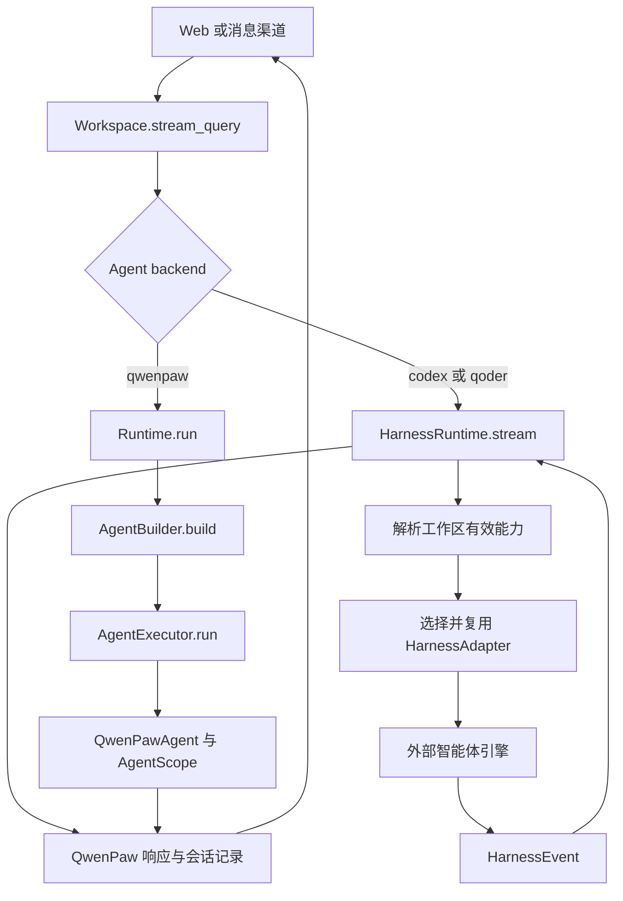
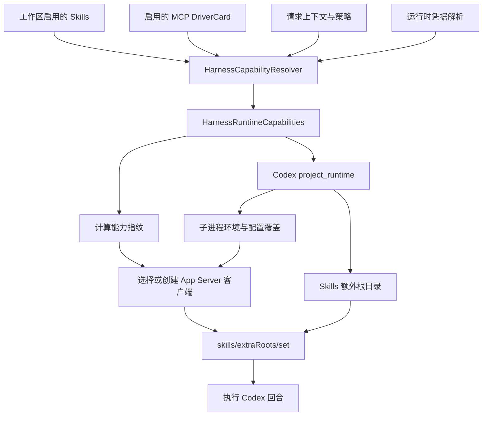
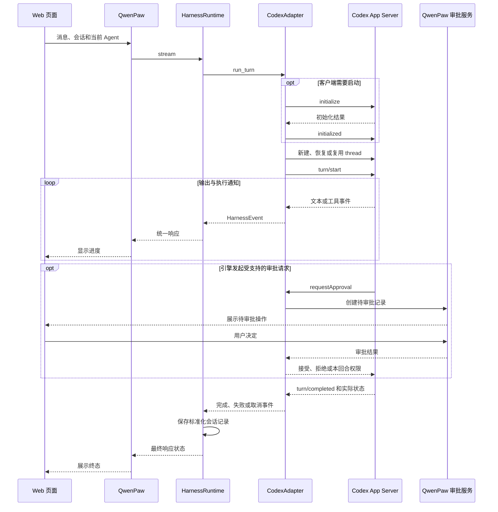
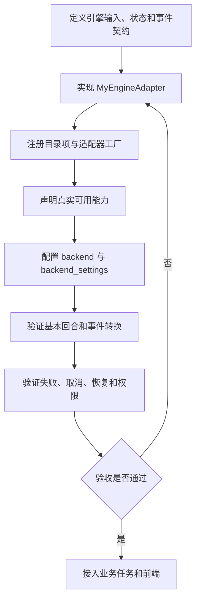

# QwenPaw Harness 接入与能力指南

本文说明 QwenPaw 如何接入外部智能体引擎、适配器能够提供哪些能力，以及如何增加自己的执行后端。

- 源码基线：QwenPaw **2.2.2**，运行时代码基线提交 `5c56644a6e130762a236f8c946103e95a0a1eec8`。
- **现有实现**指在该基线源码中确认的机制；**开发建议**指需要额外实施的扩展方案。
- 更广泛的角色、工具、界面和上下文定制选型，参见 [QwenPaw 定制开发指南](CUSTOMIZATION_GUIDE.zh.md)。

## 1. Harness 接在哪一层

QwenPaw 在工作区请求分发层选择执行后端。`Workspace.stream_query()` 读取当前 Agent 的 `backend`：

- `qwenpaw`：进入原生 Runtime，装配并执行 QwenPawAgent。
- 其他后端：进入 HarnessRuntime，由注册的 HarnessAdapter 调用外部引擎。

因此，Harness 与原生 Agent 是并列的执行路径。将 Agent 的后端设为 Codex，表示这个 Agent 的请求交由 Codex 执行；原生 Agent 自动将 Harness 当作工具调用，则需要另外设计工具或编排入口。

下面是**现有调用关系的简化图**：



源码入口：[Workspace](src/qwenpaw/app/workspace/workspace.py)、[原生 Runtime](src/qwenpaw/runtime/runtime.py)、[HarnessRuntime](src/qwenpaw/harnesses/runtime.py)。

## 2. 从配置到运行实例

### 2.1 选择执行后端

下面是 Agent 配置中的**示例片段**，需要合并到完整 Agent 配置；它不是独立 API 请求的完整请求体：

```json
{
  "backend": "codex",
  "backend_settings": {
    "binary": "codex",
    "reasoning_effort": "medium",
    "sandbox": "workspace-write",
    "approval_policy": "on-request"
  }
}
```

可以额外指定当前账号实际可用的 `model`。不同引擎接受的 `backend_settings` 不同，应由适配器进行转换和校验。

每个 Agent 可以选择自己的后端。选择后端、切换模型与跨引擎迁移会话是三个不同操作，不能仅改 `backend` 就假设原引擎的内部执行状态已迁移。

### 2.2 注册表与实例管理

当前实现使用 [registry.py](src/qwenpaw/harnesses/registry.py) 中的显式目录和工厂：

| 入口 | 作用 |
| --- | --- |
| `PROVIDER_CATALOG` | 声明引擎 ID、名称、是否待支持及能力 |
| `get_provider()` | 查找引擎目录项 |
| `create_adapter()` | 根据引擎 ID 创建适配器 |
| `adapter_config_key()` | 判断哪些配置变化需要重建适配器 |

源码目录项包括 Codex、Qoder；Claude Code 标记为 `coming_soon`。目录中有条目并不代表当前机器已安装或认证。

`Workspace.harness_runtime` 按需创建工作区自己的 HarnessRuntime。后者缓存适配器；配置键发生变化时停止旧适配器，再创建新实例。当前 Codex/Qoder 的实例配置键包含 `binary`。

CodexAdapter 还会按有效能力指纹管理 App Server 客户端。因此，“工作区中的一个适配器”与“只有一个引擎子进程”不能简单等同。

## 3. HarnessAdapter 接口

适配器接口定义在 [base.py](src/qwenpaw/harnesses/base.py)。

| 接口 | 是否必须实现 | 职责 |
| --- | --- | --- |
| `status()` | 是 | 返回安装、认证、错误和运行位置等状态 |
| `start_login(device_code=False)` | 是 | 发起引擎自己的登录流程，或明确说明不支持 |
| `logout()` | 是 | 执行引擎退出登录，或明确说明不支持 |
| `run_turn(...)` | 是 | 运行一轮请求，流式产生 HarnessEvent |
| `stop()` | 是 | 释放引擎进程、连接和其他资源 |
| `models()` | 有默认实现 | 返回模型列表，默认空列表 |
| `history(session_id)` | 有默认实现 | 返回用于恢复展示的标准化历史，默认空列表 |
| `discover_mcp(cwd)` | 有默认实现 | 发现引擎自己配置的 MCP，默认空列表 |
| `discover_skills(cwd)` | 有默认实现 | 发现引擎自己配置的 Skills，默认空列表 |
| `run_command(...)` | 有默认实现 | 执行支持的命令，默认产生不支持错误事件 |
| `reset_session(session_id)` | 有默认实现 | 重置会话关联，默认无操作 |

核心执行契约是：

```python
def run_turn(
    self,
    *,
    session_id: str,
    prompt: str,
    cwd: Path,
    settings: dict[str, Any],
    attachments: list[HarnessAttachment] | None = None,
) -> AsyncIterator[HarnessEvent]:
    ...
```

上面是接口签名示意，完整导入和实现参见源码。实现时可以使用异步生成器逐条产生事件。

### 能力声明的职责

`HarnessCapabilities` 表达模型选择、附件、推理输出、工具流、会话恢复、Skills/MCP 投射、能力发现、命令和审批预设等支持情况。

这些声明供控制台和上层逻辑判断哪些功能可用。将字段设为 `True` 不会自动实现对应接口；适配器的行为、实际引擎支持及前端入口必须保持一致。

## 4. Skills 与 MCP 如何传给外部引擎

### 4.1 两个方向

- **能力发现**：读取外部引擎自身已有的 Skills、MCP 配置，标准化后供 QwenPaw 展示。
- **能力投射**：将 QwenPaw 管理的有效 Skills、MCP 配置转换为外部引擎可使用的形式。

两者可以分别支持。例如当前目录中 Qoder 声明支持 Skills 发现，但未声明引擎侧 MCP 发现。

下面是**现有 Codex 能力投射链路的简化图**：



### 4.2 解析和投射的具体内容

[HarnessCapabilityResolver](src/qwenpaw/harnesses/capabilities/resolver.py) 会解析当前请求有效的 Skills、MCP 服务、工具白名单和策略，以及连接所需的环境变量或请求头。能力模型见 [capabilities/models.py](src/qwenpaw/harnesses/capabilities/models.py)。

Codex 的 [project_runtime()](src/qwenpaw/harnesses/codex/projection.py) 将这些能力转换为配置覆盖、环境变量和技能目录。适配器再设置 `skills/extraRoots/set`，并在发起回合前完成客户端准备。

凭据在运行时解析，并在必要的进程或服务边界提供。能力指纹采用配置、版本及修订信息，避免直接将明文凭据作为公开指纹内容。扩展实现也应避免将解析后的环境和请求头打印到日志。

能力投射与原生工具注册各有路径。一个普通 QwenPaw 原生工具插件是否能被 Codex 使用，需要检查是否存在 Codex 可调用的接入方式，例如对应 MCP 服务。

## 5. Codex 调用实例

当前客户端以子进程形式启动 `codex app-server --listen stdio://`，通过 JSON-RPC 请求和通知交互。主要实现位于 [app_server.py](src/qwenpaw/harnesses/codex/app_server.py) 与 [adapter.py](src/qwenpaw/harnesses/codex/adapter.py)。

下面是**现有正常回合与可选审批交互的简化时序**，省略能力投射和部分通知：



审批可能出现在执行过程中的任意相关阶段；图中的审批块用于展示交互关系。

### 5.1 当前 Codex 适配器的能力范围

| 能力 | 现有实现 |
| --- | --- |
| 安装与认证 | 查询本地引擎、读取账号状态、发起登录及退出 |
| 模型 | 读取模型目录，传递模型与推理强度设置 |
| 文本与工具流 | 转换文本、引擎提供的 reasoning 输出、工具状态 |
| 回合与线程 | 创建、复用或恢复线程，保存会话关联 |
| 附件 | 将文件、图片转换为引擎支持的回合输入 |
| Skills/MCP | 投射工作区有效能力，发现引擎自身能力 |
| 命令 | 注册 `/compact`、`/review`、`/skills`、`/status` |
| 审批与沙箱 | 传递执行设置，对接受支持的审批请求 |
| 取消与停止 | 回合取消时尝试中断引擎，停止时释放客户端 |
| 历史 | 读取引擎历史并与 QwenPaw 会话展示衔接 |

模型目录不等于账号对每个模型都拥有调用权限；实际推理成功才验证了该次请求的可用性。reasoning 输出取决于引擎公开的事件，不能据此假设可以访问全部内部推理过程。

### 5.2 审批、取消与完成

当前 CodexAdapter 识别命令执行、文件修改和权限请求三类 `requestApproval`。它将请求转为 QwenPaw 审批摘要并等待决定；权限请求的批准以 `scope: turn` 返回。未识别的服务端请求采用拒绝响应。

`run_turn()` 收到 Python 任务取消时，会在已有回合标识的情况下调用引擎中断接口，再传播取消。适配器的 `stop()` 负责释放资源；仅关闭网页连接不能在所有调用模式下等同为任务已被取消。

`turn/completed` 表示回合到达终态。适配器检查实际状态并转换错误或取消信息；HarnessRuntime 再输出成功、失败或取消响应。业务任务是否验收通过，还应检查业务侧定义的结果。

## 6. 事件转换与会话管理

### 6.1 统一事件

[HarnessEvent](src/qwenpaw/harnesses/events.py) 包含 `kind`、`text`、`item_id`、`tool_name` 和扩展 `data`。当前事件类型如下：

| 事件 | 用途 |
| --- | --- |
| `text_delta` | 普通文本增量 |
| `reasoning_delta` | 引擎公开的 reasoning 增量 |
| `tool_started` | 工具执行开始 |
| `tool_progress` | 工具执行进度 |
| `tool_completed` | 工具执行结束 |
| `completed` | 适配器的正常完成事件 |
| `cancelled` | 取消信息 |
| `error` | 错误信息 |

HarnessRuntime 使用 TextStream、ToolStream 等组件，将内部事件转换为 QwenPaw 消息与响应协议，并增加响应状态、时间及序列号。前端主要消费统一协议，因此可以复用聊天和工具展示组件。

适配器必须把引擎失败明确转换为错误或异常。当前 Runtime 在未记录错误或取消时，会将正常结束的事件流收束为完成，不能静默吞掉引擎失败。

### 6.2 三种状态分别维护

| 状态 | 当前职责 | 恢复时要检查什么 |
| --- | --- | --- |
| QwenPaw 会话记录 | 标准化用户输入与引擎输出，用于历史展示 | 是否保存、是否重复、属于哪个用户与会话 |
| 引擎线程与关联 | 外部引擎继续执行所需的线程状态 | 原线程是否存在、能否恢复、是否关联正确 |
| 业务任务状态 | 业务阶段、验收、重试和产物，需自建 | 重启后继续哪一步、哪些操作已经发生 |

[HarnessSessionBridge](src/qwenpaw/harnesses/session.py) 负责标准化会话的追加、清空与按需填充。`hydrate_session()` 在 QwenPaw 尚无对应历史时尝试读取引擎历史填充。

CodexAdapter 将 QwenPaw 会话与 Codex 线程的映射保存在工作区 `harnesses/codex_sessions.json`。恢复展示出的历史与恢复原引擎线程是相关但独立的操作。

`/new`、`/clear` 在 HarnessRuntime 中处理会话重置；这不能理解为已经删除引擎端所有持久化历史或外部业务数据。

## 7. 控制边界与组合方式

| 需求 | Harness 可以承担的部分 | 需要另行实现或确认的部分 |
| --- | --- | --- |
| 定制任务输入 | 文本、附件、工作目录与受支持参数 | 资料检索、业务权限和上下文准备 |
| 控制内部模型调用 | 传递引擎支持的控制项 | 每次模型输入、重试与内部循环取决于引擎接口 |
| 记忆与压缩 | 会话展示和引擎支持的命令 | 原生 Scroll 不会自动接管 Codex 线程 |
| 工具治理 | MCP 策略投射与受支持审批 | 不代表所有引擎本地工具均经过原生 Tool Guard |
| 多阶段任务 | 多次调用执行器 | 状态机、验收、重试、调度与业务幂等 |
| 多用户产品 | 提供执行接入和上下文关联 | 用户授权、凭据隔离、运行隔离与配额 |

原生 Runtime 的 Middleware 与八阶段 Hook 运行在原生路径。希望同时覆盖原生和 Harness 的资料准备、审计或业务流程，应选择分流之前的公共入口、业务服务或分别实现两个分支。

如果希望“原生助手按需调用 Codex”，可以额外封装一个工具或业务编排入口；应明确子任务输入、权限、超时、回传结果和会话关联。当前选择 `backend: codex` 的机制本身承担的是整个 Agent 请求的后端选择。

## 8. 增加自己的执行引擎

本节是**开发建议**，尚未在当前项目中实现新的引擎。



### 8.1 实施步骤

1. **定义边界**：明确引擎是本地程序还是远程服务，怎样认证、执行、取消与恢复。
2. **实现适配器**：可以按 `src/qwenpaw/harnesses/my_engine/adapter.py` 组织代码，实现必需接口；不支持的能力明确返回不支持或保持能力关闭。
3. **映射事件**：将文本、工具和终态转换为 HarnessEvent，保持工具标识和会话归属一致。
4. **注册引擎**：修改 `PROVIDER_CATALOG`、`create_adapter()`；必要时扩展 `adapter_config_key()`，避免配置变化后继续使用错误实例。
5. **处理能力投射**：如声明支持 Skills/MCP，读取 Runtime 提供的有效能力并转换为引擎支持的方式。
6. **处理会话**：明确引擎会话标识的保存、恢复与重置；按需要实现历史恢复。
7. **选择后端**：通过完整配置或受支持的 Agent 管理接口设置新 `backend`，确认控制台与路由能正确识别。
8. **完成契约验收**：先验证单轮任务，再逐项开启其他能力。

当前 Harness 工厂是显式注册方式，单独增加一个适配器文件或普通插件清单不会自动完成接入。远程引擎可以由适配器通过 HTTP、WebSocket 等方式连接，但必须自行处理连接和恢复契约。

### 8.2 验收清单

| 场景 | 验收重点 |
| --- | --- |
| 状态、登录与模型 | 未安装、未登录、失效登录及模型不可用时有明确结果 |
| 正常回合 | 输入、附件、目录正确，文本流与终态一致 |
| 工具事件 | 开始、进度和完成通过同一标识关联 |
| 异常回合 | 引擎崩溃、协议异常和远程错误不能被包装为成功 |
| 取消与超时 | 请求能够传到引擎，取消后的资源和状态符合约定 |
| 会话恢复 | 服务重启后能定位原会话，不会串到其他任务 |
| 配置变化 | 二进制、连接地址或能力变化后正确重建或重配 |
| Skills/MCP | 实际可发现、可使用；策略和凭据变化按预期生效 |
| 审批 | 同意、拒绝和超时都能结束等待，决定归属正确 |
| 并发与隔离 | 多个会话的输出、目录、凭据和线程不会混用 |

现有测试可作为参考：[HarnessRuntime 测试](tests/unit/harnesses/test_runtime.py)、[工作区分流测试](tests/unit/harnesses/test_workspace_routing.py)、[CodexAdapter 测试](tests/unit/harnesses/test_codex_adapter.py)、[能力解析测试](tests/unit/harnesses/test_capability_resolver.py)、[Codex 投射测试](tests/unit/harnesses/test_codex_projection.py)。本文变更仅涉及文档，未新增或执行引擎测试。

## 9. 源码与接口导航

| 想了解的内容 | 入口 |
| --- | --- |
| 工作区后端选择 | [workspace.py](src/qwenpaw/app/workspace/workspace.py) |
| 运行时与实例复用 | [harnesses/runtime.py](src/qwenpaw/harnesses/runtime.py) |
| 必需与可选适配接口 | [harnesses/base.py](src/qwenpaw/harnesses/base.py) |
| 注册目录、能力与工厂 | [harnesses/registry.py](src/qwenpaw/harnesses/registry.py) |
| 事件和能力模型 | [harnesses/events.py](src/qwenpaw/harnesses/events.py) |
| 配置解析与投射 | [能力解析器](src/qwenpaw/harnesses/capabilities/resolver.py)、[Codex 投射](src/qwenpaw/harnesses/codex/projection.py) |
| Codex 实现与传输 | [adapter.py](src/qwenpaw/harnesses/codex/adapter.py)、[app_server.py](src/qwenpaw/harnesses/codex/app_server.py) |
| 会话桥接 | [session.py](src/qwenpaw/harnesses/session.py) |
| 管理 HTTP 接口 | [routers/harnesses.py](src/qwenpaw/app/routers/harnesses.py) |

Harness 管理接口包含 `GET /api/harnesses`，以及指定引擎的模型、Skills、MCP 查询和状态、登录、退出操作。调用时必须选择正确 Agent 上下文；新建会话或执行任务仍通过对应聊天接入路径。

## 10. 文档验证与实际验证范围

本文包含 4 个 Mermaid 图：双执行路径、能力投射、Codex 调用时序、自定义引擎接入流程。源码链接相对项目根目录解析。

文档验收包括核对源码引用、检查相对链接、使用项目现有 Mermaid 11.16.1 解析图表，以及检查 Markdown 围栏和补丁空白。此前本机浏览器预览因 Chromium 缺少 `libnspr4.so` 无法启动，本次不将语法检查作为浏览器视觉验收。

本次验证：本文 4/4 张 Mermaid 图语法通过，29/29 个相对链接有效；关联定制指南的 7 张图及 39 个链接也已复查通过。

当前实例此前已经验证 Codex 登录、模型发现和一轮简单对话；本文列举的其他能力来自源码核对，不表示本次逐项完成运行时验收。本文与相关指南的变更不修改服务配置或执行引擎。
